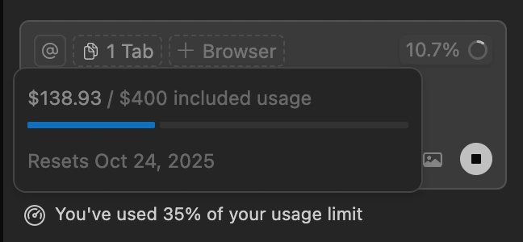

# AI Check TUI 💳

A smart command-line tool for tracking AI credit consumption across billing cycles. Designed for AI-powered development tools like Cursor, GitHub Copilot, and other subscription-based AI services.

## 🎯 Why This Matters

Managing AI credits effectively can save you money and frustration:

- **Avoid overages**: Get warned before you hit pay-as-you-go pricing
- **Optimize usage**: Know when you have credits to spare for big projects
- **Track trends**: See if you're conserving or burning through credits
- **Plan ahead**: Project your usage through the end of the billing cycle

## But my AI already shows percentage used



Yes it might! But that's only half the story. At your current rate, will you still have creates to spare at the end of the period? How much? Are you going over? 

If you have a bunch extra, you can switch to a smarter model or tackle a huge upcoming feature / project sooner rather than later. And visa versa if you're going to be over.

This is a simple CLI tool. But I find knowing the answers with clear numbers for those questions very useful.

## ✨ Features

- 📊 **Real-time Usage Analysis**: Compares your credit usage against time elapsed in billing cycle
- 🎨 **Color-Coded Feedback**: Green for conserving, red for warning, instant visual feedback
- 🔮 **Smart Projections**: Predicts remaining credits at renewal based on current usage rate
- 📅 **Flexible Billing Cycles**: Works with any renewal day of the month
- ⚡ **Zero Dependencies**: Pure Python with no external packages required
- 🧮 **Accurate Calculations**: Handles month boundaries and varying cycle lengths
- 🔒 **Privacy First**: No web services, no logins, no data collection—runs entirely offline

## 📸 Example Output

When you're conserving credits (good):
```
💳 Credit Usage Analysis
==================================================
Current Date: 2025-10-12
Billing Cycle: Day 18 of 31
Renewal Day: 24th of the month

🎯 Analysis:
  Credits Used: 25.0%
  Difference: -8.1%
  Status: CONSERVING WELL

🔮 Projection (at current rate):
  Expected usage by renewal: 43.1%
  Expected surplus: 56.9%

✅ Great! You're conserving credits - using 8.1% slower than time
   You'll have ~56.9% credits remaining at renewal.
```

When you're using too fast (warning):
```
💳 Credit Usage Analysis
==================================================
Current Date: 2025-10-12
Billing Cycle: Day 18 of 31
Renewal Day: 24th of the month

🎯 Analysis:
  Credits Used: 75.0%
  Difference: +16.9%
  Status: USING TOO FAST

🔮 Projection (at current rate):
  Expected usage by renewal: 129.2%
  Expected surplus: -29.2%

⚠️  WARNING: You're using credits 16.9% faster than time!
   💥 You'll exceed 100% usage by 29.2% before renewal!
```

## 🚀 Installation

### From PyPI (when published)

```bash
uv pip install aicheck
```

### From Source

```bash
git clone https://github.com/yourusername/ai-usage-summary.git
cd ai-usage-summary/aicheck
uv pip install -e .
```

## 📖 Usage

### Basic Usage

```bash
aicheck 15 45  # Renewal on 15th, 45% used
aicheck 25     # Default renewal day (1st), 25% used
```

### Finding Your Current Usage

**For Cursor:**
1. Open Cursor Settings
2. Navigate to your subscription/usage page
3. Look for "Usage this billing period" or similar
4. Use the percentage shown

**For GitHub Copilot:**
- Check your GitHub billing page for usage metrics

## 🔧 How It Works

The tool performs three key calculations:

1. **Time Progress**: Calculates how far through your billing cycle you are
   - Example: Day 18 of 31 = 58.1% through cycle

2. **Usage Ratio**: Compares credit usage to time progress
   - Ratio > 1.0 = Using too fast ⚠️
   - Ratio < 1.0 = Conserving well ✅
   - Ratio = 1.0 = On track 📊

3. **Projection**: Estimates final usage based on current rate
   - Daily rate = Current % ÷ Days elapsed
   - Projected = Daily rate × Total cycle days

## 📋 Requirements

- Python 3.13+ (uses modern type hints)
- No external dependencies
- Works on macOS, Linux, and Windows

## 💡 Use Cases

### Scenario 1: Pre-Project Planning
You're at 30% usage with 40% of your cycle remaining. You have credits to spare—perfect time to tackle that AI-intensive refactoring project!

### Scenario 2: Usage Warning
You're at 80% usage with 50% of your cycle remaining. Time to be more selective with AI requests or risk hitting overages.

### Scenario 3: End-of-Cycle Push
You're at 60% usage with only 5 days left. Use those remaining credits before they reset!

## 🤝 Contributing

Contributions are welcome! Feel free to:
- Report bugs
- Suggest features
- Submit pull requests

## 📄 License

MIT License - feel free to use this tool in your own projects!

## 🙏 Acknowledgments

Built for developers who want to maximize their AI tool subscriptions without breaking the bank.

---

**Pro Tip**: The package installs a `aicheck` command globally:
```bash
# If your renewal day is the 15th of the month, and usage is 45%
aicheck 15 45

# Or use the default renewal day (1st)
aicheck 25
``` 